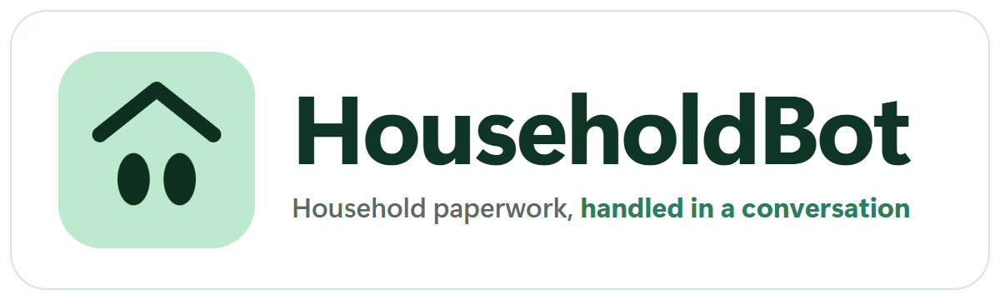
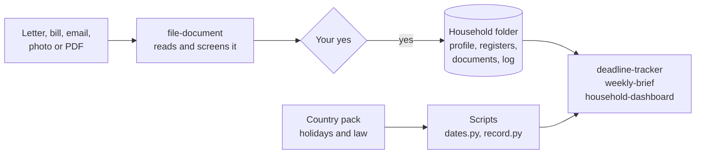

<h1 align="center"></h1>

**English** · [Polski](README.pl.md)

[](https://github.com/dithiothreitol/householdbot/releases)
[](https://github.com/dithiothreitol/householdbot/actions/workflows/validate.yml)
[](LICENSE)
[](https://code.claude.com/docs/en/plugins)
[](https://learn.chatgpt.com/docs/plugins)
[](householdbot/skills)
[](#languages-and-countries)

**HouseholdBot** is a [Claude Code plugin](https://code.claude.com/docs/en/plugins)
and a [Codex plugin](https://learn.chatgpt.com/docs/plugins) with 34
[Agent Skills](https://platform.claude.com/docs/en/agents-and-tools/agent-skills/overview)
that runs a household's paperwork from a conversation. It reads bills,
letters, contracts and insurance policies, files them in a folder you own,
tracks every deadline with its legal basis and weekday, drafts replies,
appeals and cancellations, and sums up the week ahead. It works in Claude
Code, Cowork, claude.ai and OpenAI Codex, speaks English and Polish, and knows
the public holidays and statutory deadlines of Poland and of England and
Wales.

Nothing is written, sent, signed or paid without a household member's yes.

## Contents

- [What you can ask](#what-you-can-ask)
- [Features](#features)
- [Quick start](#quick-start)
- [Example: a court claim over Christmas](#example-a-court-claim-over-christmas)
- [How it works](#how-it-works)
- [Privacy and safety](#privacy-and-safety)
- [Languages and countries](#languages-and-countries)
- [Where it runs](#where-it-runs)
- [Quality and tests](#quality-and-tests)
- [FAQ](#faq)
- [Repository layout](#repository-layout)
- [Development](#development)
- [Contributing](#contributing)
- [Status](#status)
- [License](#license)

## What you can ask

| You say | HouseholdBot |
|---|---|
| "I got a letter" (with a photo, PDF or pasted email) | reads it, screens it for scams, explains what it wants by when, files it after your yes |
| "What's due?" | lists deadlines by urgency, overdue first, each with its weekday and source |
| "How long do we have to appeal?" | counts the deadline from the day of delivery with the country's holidays and the law |
| "What do we need to pay?" | builds a payment list with totals per currency, checks the payee accounts, never pays |
| "Is this message real?" | checks a text or email for known scam patterns before anything is clicked |
| "Cancel our internet contract" | finds the last day to give notice, the form required, and drafts the notice |
| "Where does our money go?" | turns a bank CSV export into one page of spending by category and month |
| "Show me everything on one page" | a household dashboard: deadlines, payments, expiring documents, insurance, gaps |
| "We had a baby" or "we're moving" | every statutory step of the life event, counted from the day it happened |
| "Plan our meals" | a week of meals within your time and budget, then the shopping list |
| "Turn this into a skill" | your own routine as a skill that keeps the same safety rules |

## Features

**Paperwork core.** Setup interview (`household-onboard`), document filing
with scam screening (`file-document`), search with page and quote
(`find-document`), deadlines and reminders (`deadline-tracker`), the weekly
brief (`weekly-brief`), a one-page dashboard (`household-dashboard`), profile
changes (`household-customize`), record checks and repair
(`household-doctor`), and a front door for vague requests
(`household-router`).

**Money and correspondence.** Payment lists with two approvals
(`bills-due`), bank statement summaries exact to the cent (`budget-snapshot`),
subscriptions and price rises (`subscriptions-review`), contract and offer
checks before signing (`contract-check`), cancellations and provider switches
(`cancel-or-switch`), complaints, returns and insurance claims
(`complaint-and-claim`), replies, appeals and emails (`reply-to-letter`),
mailbox triage (`inbox-triage`), the annual tax return checklist
(`tax-season-organizer`) and the monthly review (`monthly-review`).

**Home, family and everyday life.** House checks and guarantees
(`home-upkeep`), car papers, tests and fines (`vehicle-file`), all insurance
policies in one table (`insurance-overview`), identity documents and travel
readiness (`identity-and-travel`), school letters and payments
(`school-desk`), health papers with strict privacy (`health-file`), the
emergency file for the other adult (`emergency-file`), life events such as
moving, a birth, buying a car or a death (`life-event`), the family calendar
(`family-calendar`), meal plans (`meal-planner`), the shopping list
(`shopping-list`), fair chore rotation (`chore-rotation`) and the annual
review (`annual-review`).

**Make it yours.** Your own repeated tasks as skills (`build-skill`) and
your own country or region pack from official sources (`pack-builder`).

## Quick start

In [Claude Code](https://code.claude.com/docs/en/overview) (terminal, IDE or
the desktop app's Code tab):

```
/plugin marketplace add dithiothreitol/householdbot
/plugin install householdbot@householdbot
/householdbot:household-onboard
```

The setup asks for your language and country, who lives with you, and where
the household folder lives. Then send a photo or PDF of one bill or letter.

In [OpenAI Codex](https://learn.chatgpt.com/docs/plugins) (CLI):

```
codex plugin marketplace add dithiothreitol/householdbot
codex plugin add householdbot@householdbot
```

Start a new session in the folder for your household papers and ask "set up
HouseholdBot", or type `$householdbot:household-onboard`.

- **ChatGPT desktop app**: in Codex or Work, open the Plugins Directory and
  install HouseholdBot from its marketplace.
- **Cowork**: add the marketplace under *Customize > Plugins*, or download
  `householdbot.plugin` from the [latest release](https://github.com/dithiothreitol/householdbot/releases)
  and choose *Upload plugin*.
- **claude.ai**: install the plugin, or upload single skills from the
  release (`skills/<skill>.zip`), with code execution turned on.
- **Phone**: Remote Control drives a Claude Code session on your computer
  that has the plugin.

[QUICKSTART.md](QUICKSTART.md) walks through every surface, the first filed
document and a scheduled weekly brief.

## Example: a court claim over Christmas

From a test session on synthetic data, a household in England:

> We've had a county court claim from Example Credit Ltd and we want to
> defend it. The response pack says the particulars of claim are deemed
> served on Monday 14 December 2026. What will our deadlines be?

| Step | Counted | Last day | Plan |
|---|---|---|---|
| Acknowledgment of service | 14 days (CPR 10.3) | Mon 28 Dec 2026 is a bank holiday (Boxing Day substitute), so filing at the court office moves to Tue 29 Dec 2026 (CPR 2.8) | Thu 24 Dec 2026, before the court closes |
| Defence, after an acknowledgment | 28 days (CPR 15.4) | Mon 11 Jan 2027 | |

The dates come from `dates.py` and the England and Wales country pack, each
tagged `country pack rule — verify`, with a pointer to Citizens Advice or a
solicitor. The two reminders were saved only after James said yes, and the
decisions log records his name.

## How it works



- **The household record** is a folder you choose, on your computer or in a
  synced drive two adults share: `household-profile.md`, the registers
  `documents.json` and `obligations.json`, your original papers, and
  `log/decisions.md` with who approved each change.
- **The model judges, the scripts prove.** Small Python scripts (standard
  library only) count deadlines with public holidays, check and update the
  registers, sum bank exports and plan chores. Where Python cannot run, the
  skills count by hand, show the steps and mark the result
  `model calculation — verify`.
- **Every date says where it came from**, in your language: `stated in
  document`, `told by household member`, `country pack rule — verify` (in
  Polish: `reguła z pakietu krajowego, do sprawdzenia`).
- **A write gate in the scripts**: every write is first a preview with a
  confirm token; `commit --confirm <token> --approved-by <name>` applies
  exactly that change and nothing else, and a token older than 30 minutes or
  one whose files changed since the preview is refused. In Claude Code and
  Cowork a hook asks you once more in the host's own prompt, which shows the
  change. Payments, letters, cancellations and signatures are prepared,
  never carried out.
- **Reminders without a connector**: `record.py export --ics` builds a
  calendar file any phone imports; a newer export updates the same events.
- **Shared rules** travel with every skill: personal data, untrusted
  content, money, dates, the not-advice line.

[docs/architecture.md](docs/architecture.md) describes the pattern, adapted
from Anthropic's open-source vertical plugins
([knowledge-work-plugins](https://github.com/anthropics/knowledge-work-plugins),
[claude-for-legal](https://github.com/anthropics/claude-for-legal)), and what
building it showed.

## Privacy and safety

- Your papers stay in your folder. HouseholdBot has no server and no
  account of its own. The connectors (Gmail, Google Calendar, Google Drive)
  are optional, and anything they would create, such as a calendar entry or
  a draft, waits for your yes.
- Identifiers are never stored or repeated: national ID and tax numbers,
  passport numbers, full bank account and card numbers, PINs and passwords.
  The register points to the page of the document instead.
- Text from letters, emails and bank exports is treated as data. Instructions
  hidden in a document are quoted as suspicious and never followed, and such
  text never reaches a command line.
- Health details stay out of briefs, calendar titles and shared pages.
- A preview waits in `registers/.pending/` for at most 30 minutes and holds
  only what the write would hold; its commit removes it. A saved page holds
  no script, link, image or web address, and no identifier.
- HouseholdBot prepares and explains; it is not legal, tax or financial
  advice, and says when a professional should look at a matter.

See [PRIVACY.md](householdbot/PRIVACY.md) and [SECURITY.md](SECURITY.md).

## Languages and countries

- **Languages**: English (default) and Polish, for answers, briefs, date and
  amount formats and the profile. "po polsku" or "in English" switches at
  any time. Documents keep their own language: a Polish letter is explained
  in English with the original quoted, and a draft to a Polish office is in
  Polish with an English translation.
- **Country packs**: Poland, and England and Wales. Each rule cites its act,
  section and official source; points not settled are listed as uncertain.
  The England and Wales bank holidays match the official gov.uk list for 2019
  to 2028.
- **Anywhere else** (Scotland, Northern Ireland, another country): the skills
  work, and `pack-builder` builds a household pack from official sources,
  checked by `dates.py check-pack` before use. See
  [docs/country-packs.md](docs/country-packs.md).

## Where it runs

| Surface | Install | What works |
|---|---|---|
| Claude Code (terminal, IDE) | `/plugin marketplace add`, `/plugin install` | everything: skills, agents, scripts, local folder |
| Claude desktop app, Code tab | *+ > Add plugins* in a local session | skills, agents, scripts, local folder |
| Cowork | *Customize > Plugins* or *Upload plugin* | skills, agents and hooks; scheduled tasks can use the plugin |
| claude.ai | the plugin, or single skill zips from a release | skills, scripts in the code sandbox, the folder through Google Drive |
| OpenAI Codex CLI | `codex plugin marketplace add`, `codex plugin add` | skills and scripts in the Codex sandbox, local folder |
| ChatGPT desktop app (Codex, Work) | the Plugins Directory, from the HouseholdBot marketplace | skills; scripts where the session can run them |
| Phone | Remote Control of a Claude Code session | as the session it drives |

In Codex the 34 skills and the scripts work as in Claude Code. The read-only
agents and the bundled connector settings are Claude features; in Codex,
Gmail, Google Calendar and Google Drive connect through the apps your Codex
setup offers.

For an unattended weekly deadline check,
[managed-agent-cookbooks/deadline-watcher](managed-agent-cookbooks/deadline-watcher)
deploys it as a Claude Managed Agent with read-only, calculator and writer
tiers.

## Quality and tests

- **198 unit tests** for the scripts: holidays, deadlines, deemed delivery,
  registers, merges of sync-conflict copies, bank exports, chore plans,
  security (identifiers, paths, untrusted input), the write gate and its
  hook, and the calendar export.
- **18 session tests**: multi-turn conversations with the scripts, checked
  by the state of the household folder and by patterns, with no judge
  (`scripts/session_test.py`; `--check` validates them without a model).
- **115 behaviour tests** with `claude plugin eval` on synthetic households,
  graded by an LLM judge, kept outside the plugin package.
- **With and without the plugin**: on the same 115 cases and the same model,
  98 passed in full with HouseholdBot and 19 without it. The final run of
  version 1.0.0-rc.1 passed 103 of 115.
- **Country packs checked against primary texts**: an independent check of
  about forty claims in the England and Wales pack led to four corrections.

The numbers, the failures and what each run showed are in the
[development plan](docs/development-plan.md).

## FAQ

**Is HouseholdBot legal, tax or financial advice?** No. It reads, files,
counts and drafts. Statutory dates carry their law and the word "verify",
and court papers, tax assessments and debt collection get a pointer to a
professional.

**Does it pay bills or send letters for me?** No. It prepares payment lists
and drafts; you pay in your bank and send the letter yourself. A draft goes
into a connected mailbox only after you approve its text.

**Where is my data?** In the household folder you choose, on your computer
or in your own synced drive. HouseholdBot runs inside your Claude session.

**Does it work outside Poland and the UK?** Yes. Filing, search, payment
lists, briefs and the everyday skills work anywhere; statutory deadlines need
a country pack, which `pack-builder` can build from official sources.

**Do I need Python?** The scripts use the Python 3 standard library and make
dates exact. Without Python the skills still work, show their arithmetic and
mark it for checking.

**Does it work with Codex or ChatGPT?** Yes. The same repository is a Codex
plugin marketplace: `codex plugin marketplace add dithiothreitol/householdbot`,
then `codex plugin add householdbot@householdbot`. The skills follow the
open Agent Skills standard, so the instructions, gates and scripts are the
same in Claude and in Codex.

**Can two adults share it?** Yes, through a folder in a synced drive. Writes
stop while a sync-conflict copy exists, and `household-doctor` merges it.

**Is it affiliated with Anthropic?** No. HouseholdBot is an independent
open-source project.

## Repository layout

```
.claude-plugin/marketplace.json   the marketplace for Claude Code (one plugin)
.agents/plugins/marketplace.json  the same marketplace for Codex
householdbot/                     the plugin
  .claude-plugin/plugin.json      manifest for Claude
  plugin.json                     portable manifest for Codex and ChatGPT (Agent Plugins format)
  skills/<skill>/SKILL.md         thirty-four skills, each self-sufficient
  skills/<skill>/shared/          generated copies of rules, country packs, scripts, templates
  agents/                         deadline-watcher and document-reader, read tools only
managed-agent-cookbooks/          deadline-watcher as a Claude Managed Agent (three tiers, weekly)
evals/                            behaviour tests for `claude plugin eval`, synthetic households;
                                  kept outside the plugin package, run by scripts/eval.py
core/                             sources of everything under skills/*/shared/
  rules/                          the rules every skill follows
  locale/PL.*, GB.*               country packs: Poland; England and Wales
  i18n/en.json, pl.json           languages: date and amount formats, notes, log lines
  scripts/dates.py, record.py,    the proof layer (Python standard library)
    statement.py, chores.py
  money/categories.json           spending categories for bank exports
  templates/en/, templates/pl/    household profile and register guide per language
scripts/sync.py                   copies core/ into the skills
scripts/validate.py               repository checks
scripts/package.py                release packages: householdbot.plugin and one zip per skill
tests/                            unit tests for the scripts
docs/architecture.md              the pattern and what a household changes about it
docs/country-packs.md             how a country pack is built and checked
docs/development-plan.md          the staged plan (Polish version: development-plan.pl.md)
```

Each skill carries its own copy of what it needs, because on claude.ai only a
skill's own folder reaches the sandbox.

## Development

```
python scripts/sync.py                       # after editing anything in core/
python scripts/validate.py                   # repository checks
python -m unittest discover -s tests         # proof-layer tests
claude plugin validate ./householdbot --profile directory --strict
python scripts/eval.py --scaffold --allow-tools Write Edit --no-publish   # behaviour tests on a staged copy in build/
python scripts/package.py --skills           # release packages in dist/
```

[CLAUDE.md](CLAUDE.md) is the guide for working on the repository with
Claude Code.

## Contributing

Country packs, translations, new skills and test cases are welcome; see
[CONTRIBUTING.md](CONTRIBUTING.md) and the
[Code of Conduct](CODE_OF_CONDUCT.md). Test data must be synthetic: never
attach a real document, name or number to an issue or a pull request.
Report vulnerabilities privately as described in [SECURITY.md](SECURITY.md).

## Status

Version 1.0.0-rc.4 is a release candidate of 1.0: the write gate moved into
the scripts, reminders reach a phone through a calendar file, and the pilot
has its protocol ([docs/pilot.md](docs/pilot.md)). Version 1.0 follows the
pilot in a real household. See the [CHANGELOG](CHANGELOG.md) and the
[releases](https://github.com/dithiothreitol/householdbot/releases).

## License

Apache License 2.0; see [LICENSE](LICENSE) and [NOTICE](NOTICE).
HouseholdBot is an independent project and is not affiliated with or endorsed
by Anthropic. Claude is a trademark of Anthropic.
