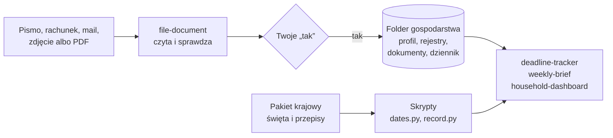

# HouseholdBot: otwarta wtyczka Claude do domowych dokumentów, rachunków i terminów

[English](README.md) · **Polski**

[](https://github.com/dithiothreitol/householdbot/releases)
[](https://github.com/dithiothreitol/householdbot/actions/workflows/validate.yml)
[](LICENSE)
[](https://code.claude.com/docs/en/plugins)
[](householdbot/skills)
[](#języki-i-kraje)

**HouseholdBot** to otwarta (open source) [wtyczka do Claude Code](https://code.claude.com/docs/en/plugins)
z 34 skillami ([Agent Skills](https://platform.claude.com/docs/en/agents-and-tools/agent-skills/overview)),
która prowadzi domową papierologię w rozmowie. Czyta rachunki, pisma, umowy i
polisy, zapisuje je w folderze, który należy do Was, pilnuje każdego terminu
z podstawą prawną i dniem tygodnia, przygotowuje odpowiedzi, odwołania i
wypowiedzenia, a co tydzień podsumowuje, co Was czeka. Działa w Claude Code,
Cowork i claude.ai, mówi po polsku i po angielsku, zna święta i terminy
ustawowe Polski oraz Anglii i Walii.

Nic nie zostaje zapisane, wysłane, podpisane ani zapłacone bez „tak” od
domownika.

## Spis treści

- [O co można zapytać](#o-co-można-zapytać)
- [Możliwości](#możliwości)
- [Szybki start](#szybki-start)
- [Przykład: pozew w okresie świątecznym](#przykład-pozew-w-okresie-świątecznym)
- [Jak to działa](#jak-to-działa)
- [Prywatność i bezpieczeństwo](#prywatność-i-bezpieczeństwo)
- [Języki i kraje](#języki-i-kraje)
- [Gdzie działa](#gdzie-działa)
- [Jakość i testy](#jakość-i-testy)
- [Najczęstsze pytania](#najczęstsze-pytania)
- [Struktura repozytorium](#struktura-repozytorium)
- [Praca nad kodem](#praca-nad-kodem)
- [Współtworzenie](#współtworzenie)
- [Stan projektu](#stan-projektu)
- [Licencja](#licencja)

## O co można zapytać

| Mówisz | HouseholdBot |
|---|---|
| „przyszło pismo” (ze zdjęciem, PDF-em albo wklejonym mailem) | czyta je, sprawdza pod kątem oszustwa, wyjaśnia, czego dotyczy i do kiedy, a po Twoim „tak” zapisuje |
| „co mamy do zrobienia?” | pokazuje terminy według pilności, zaległe na początku, każdy z dniem tygodnia i źródłem |
| „do kiedy mogę się odwołać?” | liczy termin od dnia doręczenia, ze świętami i podstawą prawną |
| „co trzeba zapłacić?” | układa listę płatności z sumami w każdej walucie, sprawdza rachunki odbiorców, nigdy nie płaci |
| „czy ta wiadomość jest prawdziwa?” | sprawdza SMS albo mail pod kątem znanych schematów oszustw, zanim cokolwiek klikniesz |
| „wypowiedz umowę na internet” | ustala ostatni dzień wypowiedzenia i wymaganą formę, przygotowuje projekt pisma |
| „na co idą nasze pieniądze?” | zamienia wyciąg z banku (CSV) w jedną stronę wydatków według kategorii i miesięcy |
| „pokaż stan wszystkiego” | pulpit gospodarstwa: terminy, płatności, kończące się dokumenty, polisy, luki |
| „urodziło nam się dziecko” albo „przeprowadzamy się” | każdy krok ustawowy zdarzenia, liczony od dnia, w którym nastąpiło |
| „zaplanuj obiady na tydzień” | jadłospis w Waszym czasie i budżecie, a potem lista zakupów |
| „zrób z tego skill” | Wasza powtarzalna czynność jako skill z tymi samymi zasadami bezpieczeństwa |

## Możliwości

**Rdzeń domowych dokumentów.** Konfiguracja (`household-onboard`),
zapisywanie dokumentów z kontrolą oszustw (`file-document`), wyszukiwanie ze
wskazaniem strony i cytatu (`find-document`), terminy i przypomnienia
(`deadline-tracker`), przegląd tygodnia (`weekly-brief`), pulpit na jednej
stronie (`household-dashboard`), zmiany w profilu (`household-customize`),
kontrola i naprawa rekordu (`household-doctor`) oraz punkt wejścia dla
ogólnych próśb (`household-router`).

**Pieniądze i korespondencja.** Listy płatności z dwiema zgodami
(`bills-due`), podsumowania wyciągów bankowych co do grosza
(`budget-snapshot`), subskrypcje i podwyżki (`subscriptions-review`),
sprawdzanie umów i ofert przed podpisaniem (`contract-check`), wypowiedzenia
i zmiana dostawcy (`cancel-or-switch`), reklamacje, zwroty i szkody
ubezpieczeniowe (`complaint-and-claim`), odpowiedzi, odwołania i maile
(`reply-to-letter`), przegląd skrzynki (`inbox-triage`), lista do rocznego
zeznania podatkowego (`tax-season-organizer`) i przegląd miesiąca
(`monthly-review`).

**Dom, rodzina i codzienność.** Przeglądy i gwarancje domu (`home-upkeep`),
dokumenty auta, badania i mandaty (`vehicle-file`), wszystkie polisy w jednej
tabeli (`insurance-overview`), dokumenty tożsamości i gotowość do wyjazdu
(`identity-and-travel`), pisma i opłaty szkolne (`school-desk`), dokumenty
medyczne z pełną dyskrecją (`health-file`), plik awaryjny dla drugiego
dorosłego (`emergency-file`), zdarzenia życiowe, takie jak przeprowadzka,
narodziny, kupno auta czy śmierć bliskiej osoby (`life-event`), kalendarz
rodzinny (`family-calendar`), jadłospis (`meal-planner`), lista zakupów
(`shopping-list`), sprawiedliwy podział obowiązków (`chore-rotation`) i
przegląd roczny (`annual-review`).

**Na Waszą miarę.** Własne powtarzalne czynności jako skille
(`build-skill`) i własny pakiet krajowy lub regionalny ze źródeł urzędowych
(`pack-builder`).

## Szybki start

W [Claude Code](https://code.claude.com/docs/en/overview) (terminal, IDE albo
zakładka Code w aplikacji desktopowej):

```
/plugin marketplace add dithiothreitol/householdbot
/plugin install householdbot@householdbot
/householdbot:household-onboard
```

Na początku wpisz „po polsku”. Konfiguracja zapyta o kraj, domowników i
miejsce folderu gospodarstwa. Potem wyślij zdjęcie albo PDF jednego rachunku
lub pisma.

- **Cowork**: dodaj marketplace w *Customize > Plugins* albo pobierz
  `householdbot.plugin` z [najnowszego wydania](https://github.com/dithiothreitol/householdbot/releases)
  i wybierz *Upload plugin*.
- **claude.ai**: zainstaluj wtyczkę albo wgraj pojedyncze skille z wydania
  (`skills/<skill>.zip`), z włączonym wykonywaniem kodu.
- **Telefon**: Remote Control steruje sesją Claude Code na komputerze, w
  której jest wtyczka.

[QUICKSTART.pl.md](QUICKSTART.pl.md) prowadzi przez każdą powierzchnię,
pierwszy zapisany dokument i przegląd tygodnia według harmonogramu.

## Przykład: pozew w okresie świątecznym

Z sesji testowej na danych syntetycznych, gospodarstwo w Anglii:

> We've had a county court claim from Example Credit Ltd and we want to
> defend it. The response pack says the particulars of claim are deemed
> served on Monday 14 December 2026. What will our deadlines be?

| Krok | Liczenie | Ostatni dzień | Plan |
|---|---|---|---|
| Potwierdzenie doręczenia (acknowledgment of service) | 14 dni (CPR 10.3) | pon. 28.12.2026 to dzień wolny (zastępczy za drugi dzień świąt), więc złożenie w sądzie przesuwa się na wt. 29.12.2026 (CPR 2.8) | czw. 24.12.2026, przed zamknięciem sądu |
| Obrona po potwierdzeniu doręczenia | 28 dni (CPR 15.4) | pon. 11.01.2027 | |

Daty liczy `dates.py` z pakietem Anglii i Walii, każda ma oznaczenie
`country pack rule — verify` i wskazanie Citizens Advice albo prawnika. Oba
przypomnienia zapisały się dopiero po zgodzie Jamesa, a dziennik decyzji
zawiera jego imię.

## Jak to działa



- **Rekord gospodarstwa** to folder, który wybieracie: na komputerze albo na
  wspólnym dysku w chmurze dla dwojga dorosłych. Zawiera
  `household-profile.md`, rejestry `documents.json` i `obligations.json`,
  oryginały dokumentów oraz `log/decisions.md` z informacją, kto zatwierdził
  każdą zmianę.
- **Model ocenia, skrypty dowodzą.** Małe skrypty w Pythonie (tylko
  biblioteka standardowa) liczą terminy ze świętami, sprawdzają i aktualizują
  rejestry, sumują wyciągi i planują obowiązki. Gdy Python nie działa, skille
  liczą ręcznie, pokazują kolejne kroki i oznaczają wynik
  `model calculation — verify`.
- **Każda data ma źródło**: `stated in document`,
  `told by household member`, `country pack rule — verify`.
- **Bramki zgody**: każdy zapis jest najpierw pokazany i wykonywany z imieniem
  zatwierdzającego; płatności, pisma, wypowiedzenia i podpisy są
  przygotowywane, nigdy wykonywane.
- **Wspólne zasady** ma każdy skill: dane osobowe, treści z zewnątrz,
  pieniądze, daty i zastrzeżenie, że to nie jest porada.

[docs/architecture.md](docs/architecture.md) opisuje wzorzec przeniesiony z
otwartych wtyczek branżowych Anthropic
([knowledge-work-plugins](https://github.com/anthropics/knowledge-work-plugins),
[claude-for-legal](https://github.com/anthropics/claude-for-legal)) i to, co
pokazała jego budowa.

## Prywatność i bezpieczeństwo

- Dokumenty zostają w Waszym folderze. HouseholdBot nie ma serwera ani
  własnego konta. Konektory (Gmail, Kalendarz Google, Dysk Google) są
  opcjonalne, a wszystko, co miałyby utworzyć, na przykład wpis w kalendarzu
  albo szkic maila, czeka na Wasze „tak”.
- Identyfikatory nigdy nie są zapisywane ani powtarzane: PESEL, NIP, numery
  dowodu i paszportu, pełne numery kont i kart, PIN-y i hasła. Rejestr wskazuje
  stronę dokumentu, na której się znajdują.
- Treść pism, maili i wyciągów to dane, nie polecenia. Instrukcja ukryta w
  dokumencie jest cytowana jako podejrzana i nigdy wykonywana, a taki tekst
  nie trafia do wiersza poleceń.
- Informacje o zdrowiu nie trafiają do przeglądów, tytułów w kalendarzu ani
  wspólnych stron.
- HouseholdBot przygotowuje i wyjaśnia. Nie udziela porad prawnych,
  podatkowych ani finansowych i mówi, kiedy sprawą powinien zająć się
  specjalista.

Szczegóły: [PRIVACY.pl.md](householdbot/PRIVACY.pl.md) i [SECURITY.md](SECURITY.md).

## Języki i kraje

- **Języki**: angielski (domyślny) i polski, w odpowiedziach, przeglądach,
  formatach dat i kwot oraz w profilu. „Po polsku” albo „in English” przełącza
  język w każdej chwili. Dokumenty zachowują swój język: pismo po angielsku
  zostaje wyjaśnione po polsku z cytatem oryginału, a projekt pisma do
  urzędu powstaje w języku urzędu, z tłumaczeniem dla domowników.
- **Pakiety krajowe**: Polska oraz Anglia i Walia. Każda reguła wskazuje akt,
  przepis i źródło urzędowe, a sprawy nierozstrzygnięte są wypisane jako
  niepewne. Święta bankowe Anglii i Walii są zgodne z oficjalną listą gov.uk
  na lata 2019–2028.
- **Gdzie indziej** (Szkocja, Irlandia Północna, inny kraj): skille działają,
  a `pack-builder` buduje pakiet gospodarstwa ze źródeł urzędowych,
  sprawdzany przez `dates.py check-pack` przed użyciem. Opis:
  [docs/country-packs.md](docs/country-packs.md).

## Gdzie działa

| Powierzchnia | Instalacja | Co działa |
|---|---|---|
| Claude Code (terminal, IDE) | `/plugin marketplace add`, `/plugin install` | wszystko: skille, agenci, skrypty, lokalny folder |
| Aplikacja Claude, zakładka Code | *+ > Add plugins* w sesji lokalnej | skille, agenci, skrypty, lokalny folder |
| Cowork | *Customize > Plugins* albo *Upload plugin* | skille, agenci i hooki; zadania zaplanowane mogą korzystać z wtyczki |
| claude.ai | wtyczka albo pojedyncze skille z wydania | skille, skrypty w piaskownicy kodu, folder przez Dysk Google |
| Telefon | Remote Control sesji Claude Code | jak sterowana sesja |

Cotygodniowe sprawdzanie terminów bez udziału człowieka zapewnia
[managed-agent-cookbooks/deadline-watcher](managed-agent-cookbooks/deadline-watcher):
wdrożenie jako Claude Managed Agent z trzema poziomami uprawnień (odczyt,
obliczenia, zapis raportu).

## Jakość i testy

- **149 testów jednostkowych** skryptów: święta, terminy, doręczenia,
  rejestry, scalanie kopii konfliktowych, wyciągi bankowe, plany obowiązków
  i bezpieczeństwo (identyfikatory, ścieżki, dane z zewnątrz).
- **115 testów zachowania** w `claude plugin eval` na syntetycznych
  gospodarstwach, oceniane przez sędziego LLM, trzymane poza paczką wtyczki.
- **Z wtyczką i bez niej**: na tych samych 115 przypadkach i tym samym modelu
  98 przeszło w całości z HouseholdBotem, a 19 bez niego. Przebieg końcowy
  wersji 1.0.0-rc.1 zaliczył 103 ze 115.
- **Pakiety krajowe sprawdzane w tekstach źródłowych**: niezależna kontrola
  około czterdziestu twierdzeń pakietu Anglii i Walii przyniosła cztery
  poprawki.

Liczby, porażki i wnioski z każdego przebiegu są w
[planie rozwoju](docs/development-plan.pl.md).

## Najczęstsze pytania

**Czy HouseholdBot udziela porad prawnych, podatkowych albo finansowych?**
Nie. Czyta, zapisuje, liczy i przygotowuje projekty pism. Terminy ustawowe mają
podstawę prawną i oznaczenie „verify”, a przy pismach sądowych, decyzjach
podatkowych i windykacji wskazuje specjalistę.

**Czy płaci rachunki albo wysyła pisma za mnie?** Nie. Przygotowuje listy
płatności i projekty pism; płacisz w swoim banku i wysyłasz pismo sam.
Szkic trafia do podłączonej skrzynki dopiero po akceptacji jego treści.

**Gdzie są moje dane?** W folderze gospodarstwa, który wybierzesz: na
komputerze albo na własnym dysku w chmurze. HouseholdBot działa w Twojej
sesji Claude.

**Czy działa poza Polską i Wielką Brytanią?** Tak. Zapisywanie dokumentów,
wyszukiwanie, listy płatności, przeglądy i skille codzienności działają
wszędzie. Terminy ustawowe wymagają pakietu krajowego, który `pack-builder`
zbuduje ze źródeł urzędowych.

**Czy potrzebuję Pythona?** Skrypty korzystają z biblioteki standardowej
Pythona 3 i zapewniają dokładne daty. Bez Pythona skille też działają,
pokazują swoje obliczenia i oznaczają je do sprawdzenia.

**Czy dwie osoby dorosłe mogą korzystać wspólnie?** Tak, przez folder na
wspólnym dysku. Zapisy wstrzymują się, gdy dysk utworzy kopię konfliktową,
a `household-doctor` ją scala.

**Czy projekt jest powiązany z Anthropic?** Nie. HouseholdBot to niezależny
projekt open source.

## Struktura repozytorium

```
.claude-plugin/marketplace.json   marketplace (jedna wtyczka)
householdbot/                     wtyczka
  skills/<skill>/SKILL.md         trzydzieści cztery skille, każdy samowystarczalny
  skills/<skill>/shared/          generowane kopie zasad, pakietów krajowych, skryptów i szablonów
  agents/                         deadline-watcher i document-reader, tylko narzędzia odczytu
managed-agent-cookbooks/          deadline-watcher jako Claude Managed Agent (trzy poziomy, co tydzień)
evals/                            testy zachowania dla `claude plugin eval`, syntetyczne gospodarstwa;
                                  poza paczką wtyczki, uruchamiane przez scripts/eval.py
core/                             źródła wszystkiego, co jest w skills/*/shared/
  rules/                          zasady, których przestrzega każdy skill
  locale/PL.*, GB.*               pakiety krajowe: Polska; Anglia i Walia
  i18n/en.json, pl.json           języki: formaty dat i kwot, notatki, wpisy dziennika
  scripts/dates.py, record.py,    warstwa dowodowa (biblioteka standardowa Pythona)
    statement.py, chores.py
  money/categories.json           kategorie wydatków dla wyciągów bankowych
  templates/en/, templates/pl/    profil gospodarstwa i opis rejestrów w każdym języku
scripts/sync.py                   kopiuje core/ do skilli
scripts/validate.py               kontrole repozytorium
scripts/package.py                paczki wydania: householdbot.plugin i zip każdego skilla
tests/                            testy jednostkowe skryptów
docs/architecture.md              wzorzec i to, co zmienia w nim gospodarstwo domowe
docs/country-packs.md             budowa i sprawdzanie pakietu krajowego
docs/development-plan.pl.md       plan etapów (wersja angielska: development-plan.md)
```

Każdy skill ma własną kopię tego, czego potrzebuje, bo w claude.ai do
piaskownicy trafia tylko jego własny folder.

## Praca nad kodem

```
python scripts/sync.py                       # po każdej zmianie w core/
python scripts/validate.py                   # kontrole repozytorium
python -m unittest discover -s tests         # testy warstwy dowodowej
claude plugin validate ./householdbot --profile directory --strict
python scripts/eval.py --scaffold --allow-tools Write Edit --no-publish   # testy zachowania na kopii w build/
python scripts/package.py --skills           # paczki wydania w dist/
```

[CLAUDE.md](CLAUDE.md) to przewodnik po pracy nad repozytorium z Claude Code.

## Współtworzenie

Mile widziane są pakiety krajowe, tłumaczenia, nowe skille i przypadki
testowe; zasady są w [CONTRIBUTING.md](CONTRIBUTING.md) i
[Kodeksie postępowania](CODE_OF_CONDUCT.md). Dane testowe muszą być
syntetyczne: do zgłoszenia ani pull requesta nie dołączaj prawdziwego
dokumentu, nazwiska ani numeru. Podatności zgłaszaj poufnie, jak opisuje
[SECURITY.md](SECURITY.md).

## Stan projektu

Wersja 1.0.0-rc.1 to kandydat do wydania 1.0; wersja 1.0 ukaże się po
pilotażu w prawdziwym gospodarstwie. Zmiany opisuje [CHANGELOG](CHANGELOG.md),
a paczki są w [wydaniach](https://github.com/dithiothreitol/householdbot/releases).

## Licencja

Apache License 2.0; szczegóły w [LICENSE](LICENSE) i [NOTICE](NOTICE).
HouseholdBot to niezależny projekt, niezwiązany z Anthropic i bez jego
poparcia. Claude jest znakiem towarowym Anthropic.
